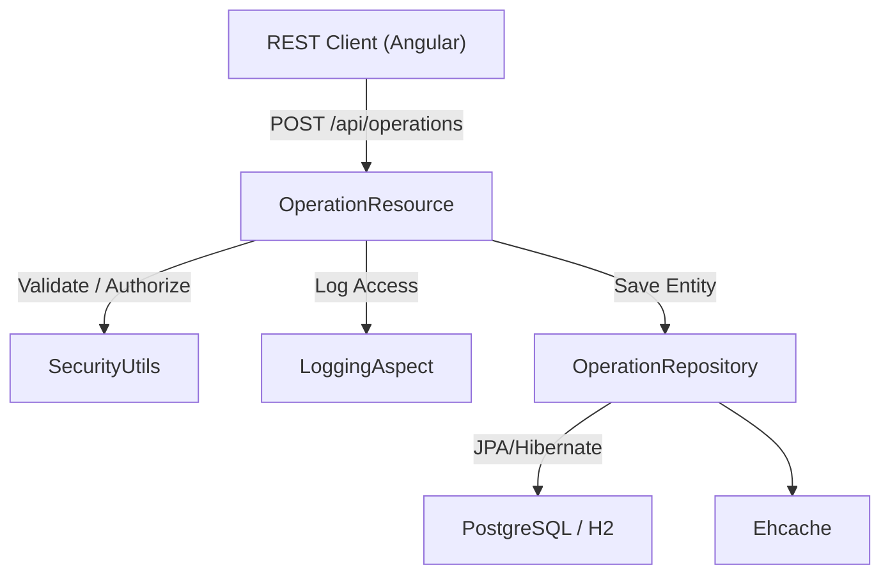
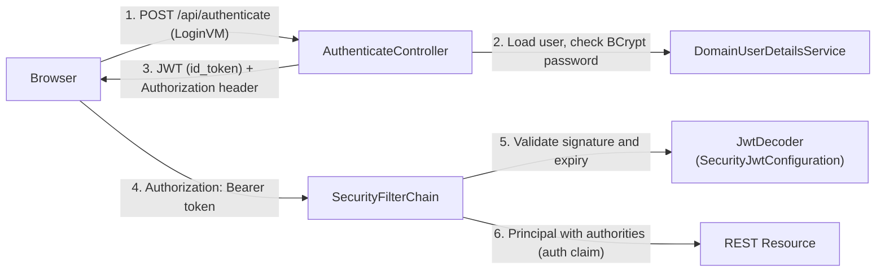
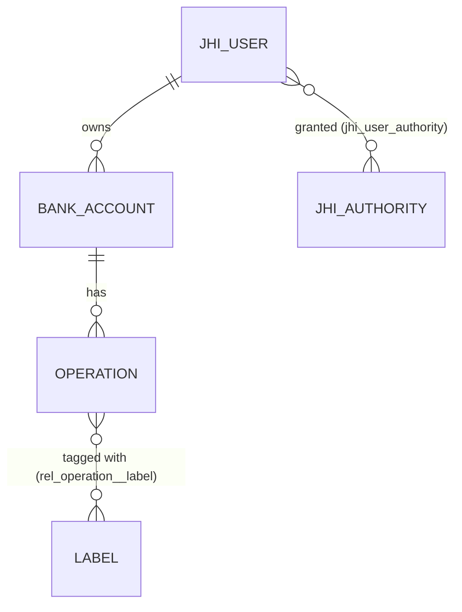

# Backend Architecture

The backend is a Spring Boot 4 application rooted at `src/main/java/io/github/jhipster/sample/`. The entry point is `JhipsterSampleApplicationApp.java`, which logs startup info and rejects incompatible profile combinations such as `dev` + `prod`. Code is split into layers, and `TechnicalStructureTest` (ArchUnit) enforces them.

| Package       | Responsibility                                                        |
| ------------- | --------------------------------------------------------------------- |
| `config`      | Spring configuration (security, cache, database, Jackson, web, async) |
| `domain`      | JPA entities                                                          |
| `repository`  | Spring Data JPA repositories                                          |
| `security`    | Authentication helpers, user details, authority constants             |
| `service`     | `UserService`, `MailService`, DTOs and `UserMapper`                   |
| `web.rest`    | REST controllers, error handling, view models                         |
| `web.filter`  | `SpaWebFilter` (forwards client routes to `index.html`)               |
| `aop.logging` | `LoggingAspect`                                                       |
| `management`  | `SecurityMetersService` (token-validation metrics)                    |

## Configuration System

Configuration is layered by Spring profile:

- `src/main/resources/config/application.yml` holds the shared settings: management endpoints under `/management`, JPA/Hibernate properties, the Docker Compose integration (`src/main/docker/services.yml`), and the profile groups (`dev` includes `api-docs`).
- `application-dev.yml` sets up H2 in-memory, the H2 console, Liquibase contexts `dev, faker`, and dev JWT and mail settings.
- `application-prod.yml` sets up PostgreSQL at `jdbc:postgresql://localhost:5432/jhipsterSampleApplication` with the Liquibase `prod` context.
- `application-tls.yml` enables HTTPS.
- Test overrides live in `src/test/resources/config/`.

Key classes in `config/`:

| Class                                                   | Role                                                             |
| ------------------------------------------------------- | ---------------------------------------------------------------- |
| `SecurityConfiguration`                                 | `SecurityFilterChain`, path authorization, CSP and other headers |
| `SecurityJwtConfiguration`                              | `JwtEncoder` / `JwtDecoder` beans (HMAC secret key)              |
| `DatabaseConfiguration`                                 | JPA repositories, auditing, H2 TCP server in `dev`               |
| `LiquibaseConfiguration`                                | Async/sync Liquibase startup                                     |
| `CacheConfiguration`                                    | Ehcache JCache caches for users, authorities and entities        |
| `WebConfigurer`                                         | CORS and servlet setup                                           |
| `StaticResourcesWebConfiguration`                       | Static asset caching (`prod` only)                               |
| `JacksonConfiguration`, `JacksonHibernateConfiguration` | JSON modules                                                     |
| `AsyncConfiguration`                                    | `@EnableAsync`, `@EnableScheduling`, task executor               |
| `LoggingConfiguration`, `CRLFLogConverter`              | Logging setup and CRLF injection protection                      |
| `ApplicationProperties`, `Constants`                    | App-specific properties and constants                            |

## Security and JWT Authentication

Authentication is stateless and uses Spring Security's OAuth2 Resource Server with JWTs signed by an HMAC key.

- **Token issuance.** `web/rest/AuthenticateController.java` creates a token with an `auth` claim (authorities) and a `userId` claim. Validity comes from `jhipster.security.authentication.jwt.token-validity-in-seconds` (24 h), or `...-for-remember-me` (30 days) when "remember me" is checked.
- **Token validation.** `config/SecurityJwtConfiguration.java` decodes tokens with `NimbusJwtDecoder` and records failures through `management/SecurityMetersService.java`.
- **Secret.** `jhipster.security.authentication.jwt.base64-secret` in `application-dev.yml` and `application-prod.yml`. Change this for real deployments.
- **User lookup.** `security/DomainUserDetailsService.java` loads users by login or email and rejects inactive accounts (`UserNotActivatedException`).
- **Authorization.** `config/SecurityConfiguration.java` disables CSRF, uses `SessionCreationPolicy.STATELESS`, and applies these path rules:
  - `/api/authenticate`, `/api/register`, `/api/activate` and the password-reset endpoints are public.
  - `/api/admin/**` and `/management/**` (except health, info and prometheus) require `ROLE_ADMIN`.
  - All other `/api/**` paths require authentication.
- **Method security.** `@EnableMethodSecurity(securedEnabled = true)` turns on the `@PreAuthorize` checks on `UserResource` and `AuthorityResource`.
- **Helpers.** `security/SecurityUtils.java` reads the current login and JWT. `security/AuthoritiesConstants.java` defines `ROLE_ADMIN`, `ROLE_USER` and `ROLE_ANONYMOUS`.

## Domain Model

Entities live in `domain/`, use Hibernate second-level caching (`@Cache(usage = READ_WRITE)`), and get their IDs from a shared `sequence_generator`.

- `BankAccount.java` has `name` and `balance`, a many-to-one `user`, and a one-to-many `operations`.
- `Operation.java` has `date`, `description` and `amount`, a many-to-one `bankAccount`, and a many-to-many `labels` stored in the `rel_operation__label` join table.
- `Label.java` has `label` (min length 3) and the inverse many-to-many `operations`.
- `User.java`, `Authority.java` and `AbstractAuditingEntity.java` support user management and auditing (`SpringSecurityAuditorAware`).
- `repository/OperationRepositoryWithBagRelationships*` eagerly loads the `labels` relationship for list and detail queries.

## Database Schema (Liquibase)

`src/main/resources/config/liquibase/master.xml` defines per-DBMS type properties (H2 and PostgreSQL) and includes the changelogs in this order:

1. `00000000000000_initial_schema.xml`: `sequence_generator`, `jhi_user`, `jhi_authority`, `jhi_user_authority`, plus seed users and authorities from `data/*.csv`
2. `20150805124838_added_entity_BankAccount.xml`: `bank_account`
3. `20150805124936_added_entity_Label.xml`: `label`
4. `20150805125054_added_entity_Operation.xml`: `operation` and `rel_operation__label`
5. `*_added_entity_constraints_BankAccount.xml` and `*_added_entity_constraints_Operation.xml`: foreign keys

Sample data in `fake-data/*.csv` loads only under the `faker` context, which the `dev` profile enables.

## REST API

All controllers live in `web/rest/`.

### User and Account Management

| Controller                  | Endpoints                                                                                                                                                                                   |
| --------------------------- | ------------------------------------------------------------------------------------------------------------------------------------------------------------------------------------------- |
| `AuthenticateController`    | `POST /api/authenticate`, `GET /api/authenticate`                                                                                                                                           |
| `AccountResource`           | `POST /api/register`, `GET /api/activate`, `GET/POST /api/account`, `POST /api/account/change-password`, `POST /api/account/reset-password/init`, `POST /api/account/reset-password/finish` |
| `UserResource` (admin)      | `POST/PUT/GET /api/admin/users`, `GET/DELETE /api/admin/users/{login}`                                                                                                                      |
| `PublicUserResource`        | `GET /api/users`                                                                                                                                                                            |
| `AuthorityResource` (admin) | `POST/GET /api/authorities`, `GET/DELETE /api/authorities/{id}`                                                                                                                             |

These delegate to `service/UserService.java` and `service/MailService.java` (Thymeleaf templates in `src/main/resources/templates/`) and use DTOs from `service/dto/`.

### Entity Resources

`BankAccountResource` (`/api/bank-accounts`), `LabelResource` (`/api/labels`) and `OperationResource` (`/api/operations`) share the generated CRUD pattern:

| Method   | Path    | Action                                                           |
| -------- | ------- | ---------------------------------------------------------------- |
| `POST`   | `/`     | Create                                                           |
| `PUT`    | `/{id}` | Full update                                                      |
| `PATCH`  | `/{id}` | Partial update (`application/merge-patch+json`)                  |
| `GET`    | `/`     | List (`OperationResource` is paginated and supports `eagerload`) |
| `GET`    | `/{id}` | Get one                                                          |
| `DELETE` | `/{id}` | Delete                                                           |

These resources call their repositories directly. There is no service layer for entities.

## Cross-Cutting Concerns

- **Error handling.** `web/rest/errors/ExceptionTranslator.java` (`@ControllerAdvice`) maps exceptions to RFC 7807 `ProblemDetail` responses. Custom exceptions include `BadRequestAlertException`, `EmailAlreadyUsedException` and `LoginAlreadyUsedException`.
- **Logging.** `aop/logging/LoggingAspect.java` (enabled in `dev` by `LoggingAspectConfiguration`) logs method entry and exit at debug level, plus exceptions thrown by repositories, services and REST controllers. `src/main/resources/logback-spring.xml` holds the logging config.
- **Caching.** Ehcache via `CacheConfiguration` serves as the Hibernate second-level cache and also backs the `UserRepository` login/email caches.
- **Monitoring.** Spring Boot Actuator lives under `/management` (health, info, prometheus, jhimetrics, and more).
- **API docs.** springdoc OpenAPI is active with the `api-docs` profile. `/v3/api-docs` is admin-only.
- **SPA routing.** `web/filter/SpaWebFilter.java` forwards non-API paths to `index.html`.
