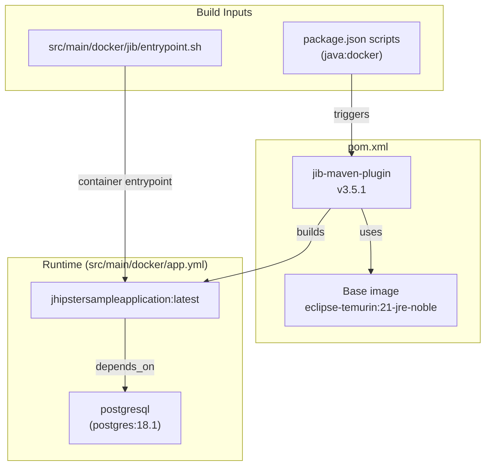

# Deployment

## Production Build

```bash
./mvnw -Pprod clean verify
java -jar target/*.jar
```

- The `prod` Maven profile (in `pom.xml`) installs Node/npm through `frontend-maven-plugin`, builds the Angular app in production mode (`webapp:prod`, which runs `ng build --configuration production`), and packages it into `target/classes/static/` inside the executable jar.
- It also sets `spring.profiles.active` to `prod`, plus any of `api-docs`, `tls`, `e2e` or `no-liquibase` enabled through their Maven profiles.
- The `prod` Spring profile (`src/main/resources/config/application-prod.yml`) expects PostgreSQL at `jdbc:postgresql://localhost:5432/jhipsterSampleApplication`. Override it with `SPRING_DATASOURCE_URL` and related variables.
- Before a real deployment, change `jhipster.security.authentication.jwt.base64-secret` and `jhipster.mail.base-url`.
- To build a WAR for an external servlet container, run `./mvnw -Pprod,war clean verify`. `ApplicationWebXml.java` provides the servlet initializer.
- The npm shortcuts are `./npmw run java:jar:prod` and `./npmw run java:war:prod`. They skip tests.

## Docker Deployment

Images are built with Jib (`jib-maven-plugin` in `pom.xml`), so you don't need a Dockerfile:

| Setting      | Value                                                                                      |
| ------------ | ------------------------------------------------------------------------------------------ |
| Base image   | `eclipse-temurin:21-jre-noble` (`jib-maven-plugin.image`)                                  |
| Architecture | `amd64` (`jib-maven-plugin.architecture`)                                                  |
| Target image | `jhipstersampleapplication:latest`                                                         |
| Entrypoint   | `/entrypoint.sh` from `src/main/docker/jib/` (honors `JHIPSTER_SLEEP` and `_JAVA_OPTIONS`) |
| Port         | 8080                                                                                       |

```bash
npm run java:docker          # ./mvnw -ntp verify -DskipTests -Pprod jib:dockerBuild
npm run java:docker:arm64    # same, for Apple Silicon / arm64
docker compose -f src/main/docker/app.yml up -d   # or: ./npmw run app:up
```

`src/main/docker/app.yml` runs the app with `SPRING_PROFILES_ACTIVE=prod,api-docs` and Prometheus export enabled. It points `SPRING_DATASOURCE_URL` and `SPRING_LIQUIBASE_URL` at the `postgresql` service, waits for that service to report healthy, and health-checks the app on `/management/health`.



For CI pipelines, JHipster's `jhipster ci-cd` sub-generator can generate configs. This repo doesn't ship any CI configuration.
