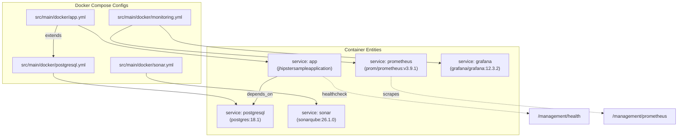

# Development Environment

## Dev Container

`.devcontainer/devcontainer.json` and `.devcontainer/Dockerfile` define a VS Code dev container:

- Base image `mcr.microsoft.com/vscode/devcontainers/java` with `VARIANT` `21-bullseye` (Java 21), plus Node.js 24.13.0 installed through nvm.
- Maven and Gradle aren't installed globally. Use `./mvnw` and `./npmw`.
- Extensions: Angular templates, ESLint, Prettier, Java pack, Spring Boot dev pack, npm IntelliSense, Jest runner.
- Forwarded ports: `4200`, `3001`, `9000` (BrowserSync) and `8080` (Spring Boot).
- The `docker-in-docker` and `docker-from-docker` features let you run the Compose files below from inside the container.

## Docker Services

All Compose files live in `src/main/docker/` and bind to `127.0.0.1` by default.

| File                          | Service(s)                                                          | Port(s)    | Shortcut                                                           |
| ----------------------------- | ------------------------------------------------------------------- | ---------- | ------------------------------------------------------------------ |
| `postgresql.yml`              | `postgres:18.1`                                                     | 5432       | `./npmw run docker:db:up` / `docker:db:down`                       |
| `services.yml`                | Extends `postgresql.yml`; used by Spring Docker Compose integration | 5432       | `./npmw run services:up`                                           |
| `app.yml`                     | `jhipstersampleapplication` image + PostgreSQL                      | 8080       | `./npmw run app:up`                                                |
| `sonar.yml`                   | `sonarqube:26.1.0.118079-community`                                 | 9001       | `docker compose -f src/main/docker/sonar.yml up -d`                |
| `monitoring.yml`              | `prom/prometheus:v3.9.1`, `grafana/grafana:12.3.2`                  | 9090, 3000 | `docker compose -f src/main/docker/monitoring.yml up -d`           |
| `jhipster-control-center.yml` | `jhipster/jhipster-control-center:v0.5.0`                           | 7419       | `docker compose -f src/main/docker/jhipster-control-center.yml up` |

In `src/main/resources/config/application.yml`, `spring.docker.compose` is set to `enabled: true` with `lifecycle-management: start-only` and `file: src/main/docker/services.yml`. The `dev` profile itself uses H2, so this Compose integration mainly matters for other profiles. Set `spring.docker.compose.enabled: false` to turn it off.

## Monitoring

- Spring Boot Actuator endpoints sit under `/management`. Health, info and prometheus are public, and the rest need `ROLE_ADMIN`. The admin UI (`/admin/metrics`, `/admin/health`, `/admin/configuration`, `/admin/logs`) reads from these endpoints.
- `monitoring.yml` starts Prometheus and Grafana. The scrape config is in `src/main/docker/prometheus/prometheus.yml`, and Grafana datasources and dashboards are in `src/main/docker/grafana/provisioning/`. `app.yml` sets `MANAGEMENT_PROMETHEUS_METRICS_EXPORT_ENABLED=true`.
- JHipster Control Center (`jhipster-control-center.yml`, http://localhost:7419) is optional.

## Code Quality

| Tool                | Config                                                         | Command                                                                             |
| ------------------- | -------------------------------------------------------------- | ----------------------------------------------------------------------------------- |
| SonarQube           | `sonar-project.properties`, `src/main/docker/sonar.yml`        | `./mvnw -Pprod clean verify sonar:sonar -Dsonar.login=admin -Dsonar.password=admin` |
| Checkstyle (nohttp) | `checkstyle.xml`, `maven-checkstyle-plugin` in `pom.xml`       | `./npmw run backend:nohttp:test`                                                    |
| ESLint              | `eslint.config.ts` (angular-eslint, Prettier, Cypress plugins) | `./npmw run lint` / `./npmw run lint:fix`                                           |
| Prettier            | `.prettierrc`, `.prettierignore`                               | `./npmw run prettier:check` / `./npmw run prettier:format`                          |
| Husky + lint-staged | `.husky/pre-commit`, `.lintstagedrc.cjs`                       | Runs `prettier --write` on staged files at commit time                              |
| EditorConfig        | `.editorconfig`                                                | Editor settings                                                                     |

Sonar picks up JaCoCo (`target/site/**/jacoco*.xml`), JUnit reports and Vitest LCOV coverage (`target/test-results/lcov.info`).
