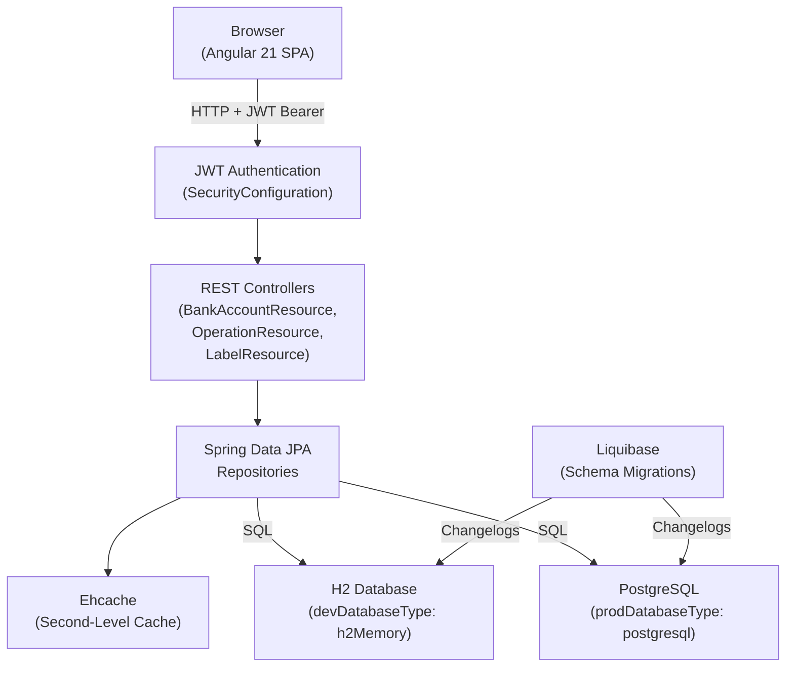
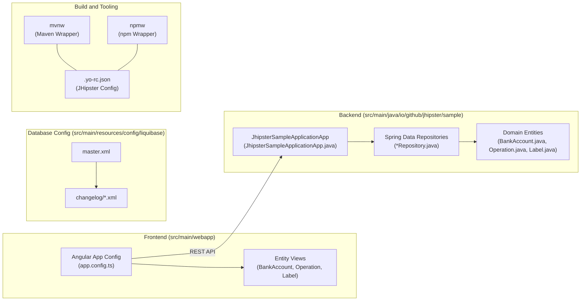

# Overview

`jhipsterSampleApplication` is a sample monolith generated by JHipster 9.0.0-beta.3 (see `.yo-rc.json`). A single deployable artifact contains the Spring Boot REST backend and the Angular single-page application, which is served as static resources. Users sign in with JWT and manage bank accounts, operations and labels through generated CRUD screens. An admin UI provides user management, metrics, health, configuration, logs and API docs.

## Technology Stack

| Layer              | Technology                                     | Source                                      |
| ------------------ | ---------------------------------------------- | ------------------------------------------- |
| Language (backend) | Java 21                                        | `pom.xml` (`java.version`)                  |
| Backend framework  | Spring Boot 4.0.2                              | `pom.xml` (`spring-boot-starter-parent`)    |
| Frontend framework | Angular 21, TypeScript 5.9                     | `package.json`                              |
| UI                 | Bootstrap 5, ng-bootstrap, Sass                | `package.json`, `.yo-rc.json` (`useSass`)   |
| Client bundler     | Webpack via `@angular-builders/custom-webpack` | `angular.json`, `webpack/`                  |
| Authentication     | JWT (Spring Security OAuth2 Resource Server)   | `.yo-rc.json` (`authenticationType: jwt`)   |
| Persistence        | Spring Data JPA / Hibernate                    | `src/main/java/.../repository/`             |
| Dev database       | H2 in-memory                                   | `.yo-rc.json` (`devDatabaseType: h2Memory`) |
| Prod database      | PostgreSQL                                     | `.yo-rc.json` (`prodDatabaseType`)          |
| Schema migrations  | Liquibase                                      | `src/main/resources/config/liquibase/`      |
| Cache              | Ehcache (Hibernate second-level cache)         | `.yo-rc.json` (`cacheProvider: ehcache`)    |
| i18n               | ngx-translate (English only)                   | `src/main/webapp/i18n/en/`                  |
| Build tools        | Maven (`mvnw`), npm (`npmw`)                   | repo root                                   |
| Tests              | JUnit 5, ArchUnit, Vitest, Gatling, Cypress    | `src/test/`, `vitest-base.config.ts`        |
| Containers         | Jib, Docker Compose                            | `pom.xml`, `src/main/docker/`               |

## Domain Entities

Entity definitions live in `.jhipster/*.json` and are implemented in `src/main/java/io/github/jhipster/sample/domain/`.

| Entity        | Table          | Fields                                                                              | Relationships                                                |
| ------------- | -------------- | ----------------------------------------------------------------------------------- | ------------------------------------------------------------ |
| `BankAccount` | `bank_account` | `name` (String, required), `balance` (BigDecimal, required)                         | many-to-one `User`; one-to-many `Operation`                  |
| `Operation`   | `operation`    | `date` (Instant, required), `description` (String), `amount` (BigDecimal, required) | many-to-one `BankAccount`; many-to-many `Label` (owner side) |
| `Label`       | `label`        | `label` (String, required, min length 3)                                            | many-to-many `Operation` (inverse side)                      |

The `Operation` list uses infinite-scroll pagination. The other entities are not paginated.

## High-Level Architecture

## Subsystem Map

## Spring Profiles

Profiles are configured in `src/main/resources/config/application*.yml`. Maven fills in `spring.profiles.active` at build time, and you can override it with `--spring.profiles.active`.

| Profile                | Purpose                                                                                                                           |
| ---------------------- | --------------------------------------------------------------------------------------------------------------------------------- |
| `dev`                  | Default for local runs. H2 in-memory database, H2 console, Liquibase `dev, faker` contexts, `api-docs` included via profile group |
| `prod`                 | PostgreSQL, Liquibase `prod` context, serves the minified frontend (`StaticResourcesWebConfiguration`)                            |
| `api-docs`             | Enables springdoc OpenAPI (`/v3/api-docs`, Swagger UI under admin)                                                                |
| `tls`                  | HTTPS using `src/main/resources/config/tls/` (`application-tls.yml`)                                                              |
| `e2e`                  | Used when packaging and running the app for Cypress in CI                                                                         |
| `testdev` / `testprod` | Test-only profiles in `src/test/resources/config/`                                                                                |

## Repository Structure

| Path                                       | Contents                                                                                     |
| ------------------------------------------ | -------------------------------------------------------------------------------------------- |
| `.yo-rc.json`                              | JHipster generator configuration                                                             |
| `.jhipster/`                               | Entity definitions (`BankAccount.json`, `Label.json`, `Operation.json`)                      |
| `pom.xml`, `mvnw`                          | Maven build and wrapper                                                                      |
| `package.json`, `npmw`                     | npm scripts and wrapper                                                                      |
| `angular.json`, `webpack/`                 | Angular CLI and custom webpack config                                                        |
| `src/main/java/io/github/jhipster/sample/` | Backend: `config`, `domain`, `repository`, `security`, `service`, `web`, `aop`, `management` |
| `src/main/resources/config/`               | Spring config, Liquibase changelogs, TLS keystore                                            |
| `src/main/webapp/`                         | Angular app (`app/`), i18n bundles, static content                                           |
| `src/main/docker/`                         | Docker Compose files, Jib entrypoint, Prometheus/Grafana config                              |
| `src/test/java/`                           | Backend tests and Gatling simulations                                                        |
| `src/test/javascript/cypress/`             | Cypress e2e tests                                                                            |
| `.devcontainer/`                           | VS Code dev container                                                                        |
